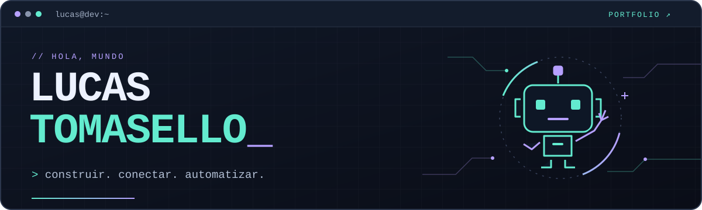

  

  <strong>Analista Programador · Argentina</strong> 
  Desarrollo aplicaciones web y de escritorio, sistemas de gestión y automatizaciones.

  <a href="https://lucast27.github.io/portfolio/"><strong>Explorar mi portfolio →</strong></a> 
  Proyectos, arquitectura y qué hice en cada uno.

---

<h3 align="center">Stack principal</h3>

  <code>Java</code> · <code>Spring Boot</code> · <code>React</code> · <code>TypeScript</code> 
  <code>Node.js</code> · <code>PostgreSQL</code> · <code>Electron</code> · <code>n8n</code>

  Abierto a oportunidades laborales. 
  <a href="mailto:lucastomasello.lt@gmail.com">Hablemos ↗</a>

